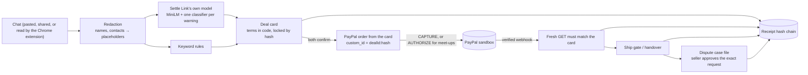

# Settle Link

[](https://github.com/mohdfaizankhan01/settle/actions/workflows/ci.yml)

**Nobody has to go first.** Strangers who agree a deal in a DM hit a standoff: the buyer won't pay first and the seller won't ship first. Scammers use that from both sides. Settle Link turns the chat into one deal link both people confirm, straight from WhatsApp Web with the Settle Link Chrome extension, or by pasting it. The buyer pays through PayPal checkout, the PayPal order carries the agreed terms, the seller ships (or hands over at a meet-up) only once PayPal itself confirms the money, and the record is on file if a dispute comes.

Built for the [PayPal AI Hackathon](https://paypalaihackathon.devpost.com). **Everything runs on the PayPal sandbox: no real money moves.** Licensed under [MIT](LICENSE).

**What's different**

- **Settle never receives money.** The buyer pays the seller's own PayPal account, connected through Partner Referrals. No escrow and no payouts.
- **The AI can't move money.** It only adds warnings. Payment counts only from a verified PayPal webhook plus a fresh read of the order; a meet-up hold is taken only when the buyer scans the seller's code.
- **Every ship check quotes PayPal's own terms**, word for word ([/terms](https://settle-ulya.onrender.com/terms)), and says that PayPal decides.
- **Starts inside the chat.** The Chrome extension reads the open WhatsApp Web chat when the seller clicks, makes the deal, and puts the buyer's link in the reply box. The seller presses Send; the extension never sends anything.
- **One record from DM to dispute.** The agreed card's fingerprint rides on the PayPal order, and disputes are answered through PayPal's Disputes API with an evidence PDF built from that record, after the seller approves the exact request.

## For judges: try it in 3 minutes

**Live app:** https://settle-ulya.onrender.com (kept awake by a regular ping; if you still see Render's wake-up page, the first load takes about a minute).

1. **[Judge mode](https://settle-ulya.onrender.com/demo)** → *Start judge mode*. You get seven private demo deals, buyer and seller side by side. Settle Link's own code runs live; PayPal is replayed from real sandbox runs, so nothing reaches PayPal.
   - *Buyer warned about Friends and Family*: the warning quotes the exact message and the PayPal terms it breaks.
   - *Seller warned about a fake payment email*: paste the "email" into *Got a payment received message?* and Settle answers from PayPal's record (not paid). Scam memory also recognises the script from two earlier (seeded) reports.
   - *Paid and ready to ship* / *HOLD after an address change*: the ship check, with each rule cited.
   - *Meet-up*: PayPal holds the money; the seller shows a QR code, you open the scan as the buyer, and only then is the money taken.
   - *A dispute with its evidence pack*: the case file, honest advice, and the exact request the seller approves.
2. **[Try to fool it](https://settle-ulya.onrender.com/demo/attacks)**: ten real attacks run against the real server code (10 of 10 stopped), each naming the rule and the test that stop it.
3. **[Proof](https://settle-ulya.onrender.com/proof)**: how often the warning check is right, and how often it raises a false alarm, on chats it never trained on. Try an honest chat too: "PayPal goods and services please, not friends and family" raises no warning.
4. **[Seller timeline](https://settle-ulya.onrender.com/demo/timeline)** (Bryntum Scheduler): every demo deal over time, coloured by its check.

5. **The Chrome extension** (optional, needs WhatsApp Web or Messenger in Chrome): download the repo, open `chrome://extensions`, turn on Developer mode, *Load unpacked* → the [`extension/`](extension) folder, then open a chat and click **Settle Link** in the toolbar. It makes a real deal on the live app (PayPal sandbox). The demo video shows it on a real WhatsApp Web chat.

**A live sandbox deal**: paste a chat at [/check](https://settle-ulya.onrender.com/check), or use the extension. Paying needs a PayPal sandbox buyer login and the seller connecting a sandbox business account; the logins are in the Devpost testing notes.

## The problem

Casual buyers and sellers in the US and UK trade with strangers on Instagram, Facebook Marketplace and WhatsApp.

- In the US, people reported losing **$2.1 billion** to scams that started on social media in 2025, and **shopping scams were the most reported kind** ([FTC Data Spotlight, Apr 27, 2026](https://www.ftc.gov/news-events/data-visualizations/data-spotlight/2026/04/reported-losses-scams-social-media-eight-times-higher-2020)). The FTC adds that most scams aren't reported, so real losses are likely much higher.
- In the UK, **purchase scams were 71% of authorised push payment scam cases** in 2025, and **66% of those cases started online** ([UK Finance, Jun 15, 2026](https://www.ukfinance.org.uk/news-and-insight/press-release/fraud-report-2026-press-release)).

Fake sellers push Friends and Family or a bank transfer, where PayPal's Purchase Protection doesn't apply. Fake buyers send a "payment received" screenshot, or ask to ship to another address, which can cost the seller Seller Protection. PayPal's protections cover both sides, but only when the deal runs through PayPal checkout, on clear terms, and the seller ships the protected way. Settle Link keeps the deal on that path.

## What it does

1. **One deal link from the chat.** Either side pastes the chat, shares it on Android straight from WhatsApp, or clicks the Chrome extension on a WhatsApp Web chat. Settle Link reads the item, price, delivery and dates, shows the message each came from, and asks both sides anything it isn't sure of. It shows PayPal's fee and both agree who pays it. Both confirm; the card is locked by its SHA-256 fingerprint. Either side can decline with a reason the other side sees first.
2. **Warnings for both sides.** Friends and Family requests, payment outside PayPal, fake payment proof, "PayPal is holding your money", overpayment refunds, codes, "ship it to my cousin", moving off the chat, and instructions aimed at the AI. Each warning quotes its message and cites PayPal's terms. The AI explains; it never approves a payment or a shipment.
3. **Pay with PayPal checkout.** The server builds the order from the locked card (total, items, and `<dealId>:<hash>` in `custom_id`), never from the browser. The money goes to the seller's own PayPal account, connected through Partner Referrals.
4. **Ship gate.** Payment counts only after a verified PayPal webhook *and* a fresh read of the order that matches the card. The checklist (payment, address, delivery method, tracking, later messages) gives Ship, Hold or Review, citing [`docs/protection-terms.md`](docs/protection-terms.md). A new address after payment holds the parcel. Tracking goes to PayPal through PayPal's TypeScript SDK.
5. **Meet-up mode.** For in-person deals, the buyer pays as a PayPal **hold** (`intent: AUTHORIZE`): PayPal keeps the money on the buyer's account, Settle never holds it. At the meet-up the seller shows a one-time QR code; the buyer checks the item, scans it on the phone that paid, and confirms; only then is the hold captured. Walking away, or no handover within PayPal's 3-day hold guarantee, releases it. The card still says plainly that in-person handovers aren't covered by Seller Protection.
6. **Disputes from the record.** A verified dispute webhook opens a case file: what the record proves for that reason, honest advice (fight, refund, offer), and an evidence PDF. The seller sees the exact request and approves it before anything is sent; PayPal decides.
7. **In the chat app.** A deal link pasted into WhatsApp, Messenger or iMessage shows a card with the item, price, delivery and status, and "Pay only through PayPal on this link. Never Friends and Family." No names, chat or contact details are in it.
8. **Settle Link for Chrome.** For sellers with many deals a day: click the toolbar button on a WhatsApp Web chat (Messenger, Facebook Marketplace and Instagram work too, or select messages on any site). It reads only that chat, only on the click, and shows who said what before anything is sent. On WhatsApp, who sent each message comes from WhatsApp's own page, never from names or typed text, so a buyer can't pass as the seller. It makes the deal through the same server path as pasting, puts the buyer's link in the reply box for the seller to send, opens the seller's own link, and lists the deals made in that browser. Permissions: only the open tab, on click (`activeTab`). Code and store listing: [`extension/`](extension).
9. **Scam memory.** Declining because the other side wanted to leave PayPal, or answering "Was this a scam? Yes" on a warning, remembers that side's PayPal account, payer ID, postcode or exact script, as keyed one-way hashes only. A later deal reported by at least two other deals in the last 90 days gets a caution. It never blocks.

## How it works



- **Redaction first.** Names, emails, phone numbers, addresses and bank details are removed before any model sees the chat. Prices, dates and links become tokens whose values stay in code.
- **Settle Link's own AI.** Each redacted message becomes a MiniLM sentence embedding (quantized, run on our server with transformers.js); one logistic-regression classifier per warning gives a probability ([`lib/model`](lib/model)). Keyword rules add certainty where a phrase is unambiguous. The warning check sends no chat text to an AI provider. Fail closed: if the check can't run, nobody can confirm the card.
- **PayPal decides, code checks.** Amounts, payee, fees and dates are handled in code. Payment counts only from a verified webhook plus a fresh GET; screenshots, emails and client callbacks never count.
- **Receipts.** Every decision writes a receipt into a per-deal hash chain; the deal history shows whether it verifies.
- **Links lock to the first device that opens them.** Whoever makes a deal gets both links, so each link works only on the device that first opened it; a meet-up hold can only be placed and released from the phone that paid.

## How it compares

| | PayPal alone | Escrow-style apps | Settle Link |
| --- | --- | --- | --- |
| Turns the chat into terms both sides confirm | No | Some | Yes, every term quotes its message |
| Warns about scams in the chat, for both sides | No | Rarely | Yes, ten warnings, each citing PayPal's terms |
| Who holds the money | PayPal | Often the app, or an AI decides release | PayPal only; meet-ups use a PayPal hold the buyer releases |
| "Is this payment real?" | Your PayPal account | Varies | Answered from this deal's PayPal order, never a screenshot |
| Disputes | Resolution Center | Varies | Evidence pack from the record; the seller approves the exact request |

Other approaches in this hackathon, and where Settle Link differs:

- **Escrow, then payout.** The app takes the buyer's money and pays the seller later. Settle Link never receives money: the buyer pays the seller's own PayPal account.
- **An AI decides when money is released** (for example after checking a delivery photo). In Settle Link the AI can't move money; PayPal's records and the two people do.
- **Scam checks before paying, or ship checks before posting, on their own.** Settle Link runs both on the same locked card, and the same record later answers a dispute.
- **Dispute desks.** Settle Link's case file starts at the chat, and the seller approves the exact request sent to PayPal's Disputes API.

## What's real and what's simulated

| Part | Live | Simulated |
| --- | --- | --- |
| PayPal (orders, holds, captures, webhooks, tracking, disputes) | Live PayPal **sandbox** on real deals | Replayed from recorded sandbox runs in judge mode, labelled on screen |
| Warning check | Settle Link's own model and rules, on every chat | — |
| Test chats on /proof | — | 83 chats we wrote; a sanity check, not a benchmark |
| Scam memory | Real reports between real deals | Judge mode seeds two earlier reports, labelled |
| Chrome extension | Reads real web chats on click; makes real deals on the live app | — |
| Money | — | Sandbox only: no real money moves anywhere |

## Proof

- **271 tests** (`npm test`, run by CI on every push), with PayPal and the model mocked; a Playwright walk of the judge path on the deployed app (`npm run e2e`); and 8 Playwright tests of the extension's chat readers, including a buyer who types a fake `[time] Seller:` line or takes the seller's name (`npx playwright test e2e/extension-readers.spec.ts`). The /proof page shows the 240 tests at its last snapshot.
- **10 of 10 attacks stopped** on [/demo/attacks](https://settle-ulya.onrender.com/demo/attacks), each tied to a named test.
- **Warning check on 83 held-out chats** (model plus rules): precision 73%, recall 95%, versus 38% recall for keyword rules alone. Weakest: "move to another app" (recall 67%) and "ship somewhere else" (80%). A missed warning never makes a deal safe: payment and shipping are still checked against PayPal's records.
- **False alarms:** 32 of 39 chats with nothing risky show no warning, and 6 of 7 honest refusals ("not friends and family", "I don't take Zelle") show none. Refusals are handled in code; a question ("why not F&F?") is never read as a refusal.
- **Live sandbox runs** with PayPal debug IDs in [`docs/SPIKES.md`](docs/SPIKES.md): seller onboarding, capture, tracking, refunds, a dispute answered with an evidence PDF, and a full meet-up (hold, QR handover, capture), each confirmed by verified webhooks.

## Safety rules

- PayPal sandbox only; all PayPal calls run on the server ([`lib/paypal.ts`](lib/paypal.ts)); secrets live in environment variables.
- Settle Link never holds money and never says a deal is "safe" or "protected": it says which checks pass and that PayPal decides.
- The AI only adds caution. It never approves a payment, a shipment or a handover, and never writes dispute text (that is templated from the record).
- Any error means Hold or Review, never "safe".
- The Chrome extension reads a chat only when the seller clicks, never presses Send, and never opens the buyer's link. What it reads and keeps is on [/privacy](https://settle-ulya.onrender.com/privacy).

## Limitations

- Sandbox only, on a free Render instance.
- The warning check is trained and tested on chats we wrote; real chats will be messier. About 1 in 5 chats with nothing risky still gets a warning; a warning adds caution and never blocks a deal on its own.
- Delivery for a dispute is entered by the seller from the carrier's page; Settle doesn't read carrier tracking itself.
- In-person handovers stay outside PayPal Seller Protection and Item Not Received; meet-up mode makes the payment real before you meet, it doesn't add cover.
- Sharing a chat *into* Settle Link works on Android (installed from Chrome's menu); on iPhone, copy and paste. Link previews work everywhere.
- Scam memory matches the same script word for word (after names, prices and links are removed), not reworded versions, and needs two reporting deals before it says anything. Two deals aren't proof of two different people: one person could make two deals and report a script. That's why memory only adds a caution and never blocks.
- A deal link locks to the first device that opens it; switching phones means asking for a new link.
- The Chrome extension works on chat sites in a desktop browser, not in phone apps (phones use the share sheet or copy and paste). It reads only messages already loaded on the page. The WhatsApp Web reader was checked on a live chat on 10 Nov 2026; Messenger, Marketplace and Instagram use a layout reader tested on sample pages, and the seller checks the preview. Chat sites change their pages, so readers can break; selecting the messages still works. Store listing pending.

## Tools used

- **PayPal (sandbox):** Orders v2 (capture and authorize), Payments v2 (authorization capture and void), JS SDK v6, Partner Referrals and merchant-integrations (seller onboarding), Webhooks with `verify-webhook-signature`, Disputes API, order tracking through the **APIMatic**-generated PayPal TypeScript SDK.
- **AI:** Settle Link's own warning model (MiniLM embeddings via transformers.js, logistic regression per warning, trained in this repo). Jev (TypeSafe) is supported behind `JEV_PROVIDER=typesafe` but wasn't used (no credits).
- **Bryntum Scheduler** for the seller timeline. **Render** for hosting, **Neon** for Postgres. **pdf-lib** for evidence packs, **qrcode** for handover codes.
- Built with **Claude Code**, using the PayPal plugin (best practices, sandbox MCP), the APIMatic context plugin for PayPal, the Render plugin, Playwright, and code and security review plugins.
- Started from PayPal's [AG Grid hackathon boilerplate](https://github.com/paypaldev/hackathon-paypal-ag-grid-boilerplate) (Next.js, AG Grid, AG Studio); its data pages are kept for local development only.

## Run it yourself

Requires Node.js 22 (`nvm use` reads `.nvmrc`), a PayPal sandbox REST app of type **Platform**, and Postgres (optional locally: without `DATABASE_URL`, development uses an in-memory store).

```bash
git clone https://github.com/mohdfaizankhan01/settle.git && cd settle
nvm use
npm install
npm run model:fetch         # once: downloads the 24 MB MiniLM model into ./models
cp env.example .env.local   # fill in PAYPAL_CLIENT_ID, PAYPAL_SECRET and the others
npm run dev                 # http://localhost:3000, then open /demo or /check
npm test                    # unit tests, with PayPal and the model mocked
npm run ext:pack            # Chrome Web Store zip of extension/ → dist/
```

- **Webhooks** need a public URL: deploy (see [`render.yaml`](render.yaml)) or tunnel, register `<host>/api/paypal/webhook` in the sandbox app with the payment, authorization, dispute and onboarding events, and put its ID in `PAYPAL_WEBHOOK_ID`.
- **Scam memory** needs `SETTLE_MEMORY_KEY` (at least 32 random characters) in production; without it, memory is off.
- **Retrain the model:** `npm run model:train`, then `npm run eval` (never train on `data/test-chats.jsonl`). `npm run proof` refreshes the numbers on /proof.
- **Planning notes:** code comments cite "PLAN M1–M6" and "DECISIONS #n" from our private planning notes, which aren't in this repo. The evidence those decisions rest on is public: [`docs/SPIKES.md`](docs/SPIKES.md) (sandbox calls with debug IDs), [`docs/protection-terms.md`](docs/protection-terms.md) and [`docs/fees.md`](docs/fees.md).

## Team setup (Claude Code)

The project-scope plugins are listed in `.claude/settings.json` and `ag-mcp` in `.mcp.json`. Each teammate runs once:

```bash
claude plugin marketplace add anthropics/claude-plugins-official   # if not already listed
claude plugin marketplace add typesafe-ai/skills
claude plugin install paypal@claude-plugins-official --scope project
claude plugin install typesafe@typesafe-ai --scope project
claude plugin install render@claude-plugins-official --scope project
claude plugin install security-guidance@claude-plugins-official --scope project
claude plugin install frontend-design@claude-plugins-official --scope project
claude plugin install playwright@claude-plugins-official --scope project
claude plugin install code-review@claude-plugins-official --scope project
npx context-plugins install paypal --targets claude -y   # APIMatic PayPal SDK skills (user scope)
```

Then put sandbox keys in `.env.local`, a sandbox access token in your **user** settings as `env.PAYPAL_SANDBOX_ACCESS_TOKEN` (`/paypal:setup` does this), and restart Claude Code.

## Appendix: boilerplate data pages

The starter's PayPal data pages (`/products`, `/plans`, `/invoices`, `/transactions`, `/balances`) and the AG Studio report at `/dashboard` are available in local development only (production answers 404 unless `SETTLE_DEV_PAGES=1`). They read the sandbox account with plain `fetch` in [`lib/paypal.ts`](lib/paypal.ts) and show each endpoint in an AG Grid. The dashboard's optional AI assistant uses `AG_STUDIO_OPENAI_API_KEY` (or `OPENAI_API_KEY`) through the server-side proxy at `/api/ai/responses`; it has no auth, so don't enable it publicly with a real key.
